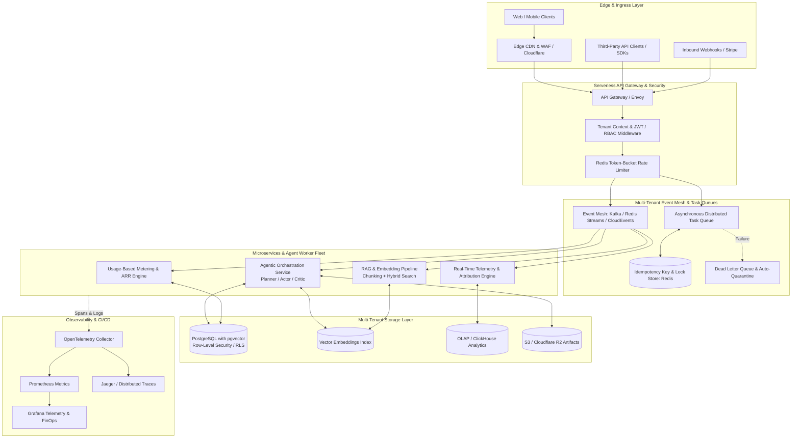

# AI-Native Enterprise SaaS Platform Architecture

> **Architectural Blueprint & Implementation Guide for an ARR-Driven, Multi-Tenant, Event-Driven AI SaaS Engine.**

---

## 📌 Foundational Prompt & Project Mandate

```text
Architect an AI-native SaaS platform for targeting annual recurring revenue using a multi-tenant event-driven architecture with serverless compute, containerized microservices, and API-first integrations. 

Implement agentic orchestration, retrieval-augmented generation, vector embeddings, and asynchronous tasks, queues with idempotent execution and fault-tolerant retries. 

Instrument the acquisition funnel with real-time telemetry, cohort analytics, attribution modeling, and automated A/B testing to optimize activation, retention, and LTV-to-CAC ratios. 

Prioritize product-led growth, usage-based monetization, horizontal scalability, and defensible data feedback loops, supported by CI/CD pipelines, infrastructure as code, distributed tracing, role-based access control, and end-to-end observability.
```

---

## 🏗️ 1. High-Level System Architecture

The platform employs a **hybrid compute topology**: low-latency ingress and webhooks execute on serverless edge runtimes, while agentic workflows, vector indexing, and analytical pipelines run on containerized microservices orchestrated via an event mesh.



---

## 🏢 2. Multi-Tenancy & Zero-Trust RBAC

### Tenant Isolation Model
- **Data Layer Isolation**: PostgreSQL with Row-Level Security (`RLS`) keyed on `tenant_id`. Every connection checks tenant claims:
  ```sql
  ALTER TABLE workspaces ENABLE ROW LEVEL SECURITY;
  CREATE POLICY tenant_isolation_policy ON workspaces
    FOR ALL
    USING (tenant_id = current_setting('app.current_tenant_id', true)::uuid);
  ```
- **Context Propagation**: Edge Gateway inspects incoming JWTs, extracts `tenant_id`, `role`, and scope permissions, binding them to async thread-local / request contexts.
- **Hierarchical Role-Based Access Control (RBAC)**:
  | Role | Permissions | Scope |
  | :--- | :--- | :--- |
  | **Owner** | Full workspace administration, billing, audit logs, API key issuance | Workspace |
  | **Admin** | Member management, agent creation, integration config | Workspace |
  | **Member** | Prompt execution, RAG query submission, workflow triggers | Workspace / Project |
  | **Viewer** | Read-only analytics, report viewing, trace inspection | Project |
  | **Service Bot** | Machine-to-machine scoped API tokens | Tenant Subnet |

- **Distributed Rate Limiting**: Token-bucket algorithm in Redis evaluated per tenant tier:
  $$\text{Tokens Available} = \min(\text{BucketCapacity}, \text{Tokens}_{\text{last}} + \Delta t \times \text{RefillRate})$$

---

## 🤖 3. Agentic Orchestration & Advanced RAG

### Agentic Execution Loop (Planner-Actor-Critic)
1. **Goal Decomposition**: High-level objectives are decomposed into directed acyclic graph (DAG) execution steps.
2. **Dynamic Tool Calling**: Secure sandboxed execution for external APIs, database lookups, vector queries, and code interpreters.
3. **Reflection & Self-Correction**: Dedicated critic nodes score intermediate responses against rubric guardrails before terminal output dispatch.
4. **Human-in-the-Loop (HITL)**: Stateful checkpoints suspend tasks when confidence scores fall below threshold $\tau$, notifying admins via webhooks.

### Advanced RAG Pipeline
- **Hybrid Search**: Dense semantic vector similarity (HNSW on `pgvector`) + Sparse lexical keyword matching (BM25).
- **Reciprocal Rank Fusion (RRF)**:
  $$RRF(d) = \sum_{m \in M} \frac{1}{k + r_m(d)}$$
  *(where $k \approx 60$, and $r_m(d)$ is the rank of document $d$ in retrieval method $m$)*.
- **Cross-Encoder Reranking**: Top-$K$ candidates scored with lightweight cross-encoders to eliminate hallucinated context.
- **Data Feedback Flywheel**: Implicit user acceptance signals (copies, thumbs up, completions) feed back into RLHF / DPO fine-tuning datasets.

---

## ⚡ 4. Asynchronous Queues, Idempotency & Fault Tolerance

```
[Inbound Request] ──> [Extract Idempotency-Key] ──> [Redis SETNX with TTL]
                             │                                │
                       Key Exists?                     Key Granted?
                      ┌──────┴──────┐                         │
                     Yes            No                 [Dispatch to Worker]
                      │              │                        │
             [Return Cached]   [Acquire Lock]            [Try Execution]
                                                              │
                                                     ┌────────┴────────┐
                                                  Success           Failure
                                                     │                 │
                                              [Store Result]    [Exponential Backoff + Jitter]
                                              [Release Lock]           │
                                                                 Max Retries?
                                                                ┌──────┴──────┐
                                                               No            Yes
                                                                │             │
                                                            [Retry]        [DLQ Alert]
```

- **Idempotency Guarantee**: Requests carry an `Idempotency-Key` HTTP header. Redis distributed lock ensures exactly-once semantics across distributed worker pods.
- **Exponential Backoff with Full Jitter**:
  $$t_{\text{sleep}} = \text{random}(0, \min(t_{\text{max}}, t_{\text{base}} \times 2^{\text{attempt}}))$$
- **Dead Letter Queue (DLQ)**: Failed events after $N=5$ retries enter DLQ with full stack trace, payload snapshot, and tenant metadata for automated remediation.

---

## 📈 5. Product-Led Growth (PLG), Funnel Telemetry & Monetization

### Real-Time Acquisition & Retention Funnel
The telemetry pipeline records user milestones to compute instantaneous conversion efficiency:

```
[Visitor Landed] ──> [Signup] ──> [Workspace Init] ──> [First Agent Step (TTFV)] ──> [Usage Threshold] ──> [Paid Upgrade]
```

### Multi-Touch Attribution Engine
Computes channel ROI across complex B2B buyer journeys:
- **First-Touch / Last-Touch**: Baseline discovery vs. closing channel.
- **Linear**: Equal distribution across all touchpoints.
- **W-Shaped Attribution**:
  - $40\%$ First Touch (Brand Discovery)
  - $40\%$ Lead Creation (Workspace Signup)
  - $10\%$ Opportunity Touch (Feature Activation)
  - $10\%$ Divided across intermediate engagements

### Usage-Based Monetization & ARR Modeling
- **Blended Revenue Model**: Base platform seat subscription + dynamic credit consumption per $1\text{k}$ tokens / agent compute-second.
- **Annual Recurring Revenue (ARR)**:
  $$\text{ARR} = 12 \times \left( \sum \text{MRR}_{\text{base}} + \sum \text{Usage}_{\text{overage}} \right)$$
- **LTV-to-CAC Optimization**:
  $$\text{LTV} = \frac{\text{ARPU} \times \text{Gross Margin}}{\text{Churn Rate}}, \quad \text{Target: } \frac{\text{LTV}}{\text{CAC}} \ge 3.0$$

### Automated A/B Testing Engine
- Deterministic tenant hashing via `MurmurHash3(tenant_id + experiment_salt) % 100`.
- Bayesian probability to beat control with Sample Ratio Mismatch (SRM) continuous monitoring.

---

## 🛠️ 6. DevOps, IaC & Observability

### Infrastructure as Code (Terraform)
- **VPC & Security**: Multi-AZ subnets, private DB subnets, NAT Gateways.
- **Compute**: Serverless API Gateway / AWS Lambda for edge ingress, AWS EKS (Kubernetes) / ECS Fargate for agent microservice workers.
- **Persistence**: AWS Aurora Serverless v2 PostgreSQL (with `pgvector`), ElastiCache Redis Cluster.
- **Telemetry Storage**: ClickHouse Cloud or AWS S3 Lakehouse with DuckDB integration.

### Observability & OpenTelemetry
- Distributed trace propagation across HTTP headers and messaging queues (`traceparent` W3C format).
- GenAI Semantic Conventions: Span attributes recording `gen_ai.prompt.tokens`, `gen_ai.completion.tokens`, `gen_ai.model`, `tenant.id`.
- Prometheus metrics for latency percentiles (P50, P95, P99), queue depths, and dead-letter rates.

### Continuous Integration & Deployment (CI/CD)
- **Pipeline Gates**: Static analysis (`ruff`, `mypy`), vulnerability scanning (`trivy`, `semgrep`), unit/integration testing, Docker multi-stage builds.
- **Canary Deployments**: Progressive traffic shifting ($5\% \rightarrow 25\% \rightarrow 100\%$) backed by automatic rollback upon 5xx spike or P99 latency degradation.

---

## 📂 7. Repository Layout

```
├── .github/
│   └── workflows/
│       ├── ci.yml                 # Linting, testing, security scans
│       └── cd-canary.yml          # Container build & progressive deployment
├── infra/
│   └── terraform/
│       ├── main.tf                # VPC, EKS, RDS Aurora Serverless, Redis
│       ├── variables.tf           # Environment configurations
│       └── outputs.tf             # Endpoint outputs & connection strings
├── services/
│   ├── gateway/                   # Ingress, AuthZ & Token-Bucket Rate Limiter
│   ├── agent-orchestrator/        # Multi-Agent Planner, Tool-Calling, Critic
│   ├── rag-pipeline/              # Chunking, Embeddings, Hybrid RRF Search
│   ├── task-queue/                # Idempotent Worker, Backoff & DLQ
│   ├── billing-meter/             # Credit Ledger, Usage Billing, ARR Calculator
│   └── telemetry-analytics/       # Real-time Events, Cohort Matrix, A/B Testing
├── packages/
│   ├── common-sdk/                # Shared tenant models, CloudEvents schema
│   └── observability/             # OpenTelemetry spans & Prometheus metrics
├── docker-compose.yml             # Local multi-service simulation
├── LICENSE                        # MIT License
└── README.md                      # System Architecture Documentation
```

---

## 📜 License

This architecture specification and reference codebase is licensed under the [MIT License](LICENSE).
