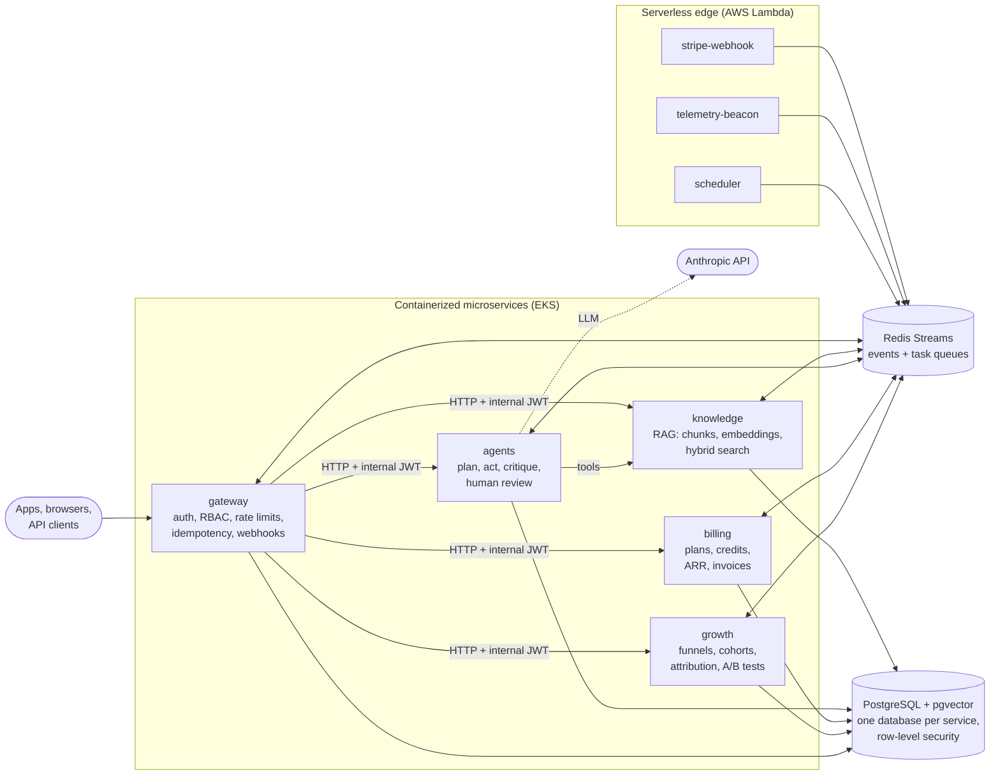

# AI-native SaaS platform

> **The brief.** Architect an AI-native SaaS platform for targeting annual recurring revenue using a multi-tenant event-driven architecture with serverless compute, containerized microservices, and API-first integrations. Implement agentic orchestration, retrieval-augmented generation, vector embeddings, and asynchronous tasks, queues with idempotent execution and fault-tolerant retries. Instrument the acquisition funnel with real-time telemetry, cohort analytics, attribution modeling, and automated A/B testing to optimize activation, retention, and LTV-to-CAC ratios. Prioritize product-led growth, usage-based monetization, horizontal scalability, and defensible data feedback loops, supported by CI/CD pipelines, infrastructure as code, distributed tracing, role-based access control, and end-to-end observability.

This repository is a working implementation of that brief. Businesses sign up
for themselves, upload their documents and ask an **AI agent** questions that it
answers from those documents, with citations. The platform meters that usage
and bills for it, measures which marketing and product changes turn visitors
into paying customers, and runs on AWS with automated testing and deployment.

New to these terms? Start with the **[beginner's guide](docs/beginners-guide.md)**.

## Try it in one minute

You need [uv](https://docs.astral.sh/uv/) and nothing else: no Docker, no cloud
account, no API keys.

```bash
uv sync --all-packages
uv run devstack demo      # simulate five weeks of a SaaS business, end to end
```

The demo drives every service the way real customers would. Here is an excerpt
of its output:

```text
2. Product-led signup - self-serve, free plan, no sales call
   12 workspaces created; each got a free subscription and a first-touch channel
3. Activation - customers upload knowledge and ask the AI agent
   Q: How long do I have to request a refund?
   A: Customers can request a full refund within 30 days of purchase [1]. ...
   Q: Which offices do you have in Brazil?  -> status=needs_review (knowledge gap=True): routed to a human
6. Usage-based monetization - credits, quota nudges and upgrades
   next run -> HTTP 402 quota_exceeded: upgrade_to=pro
8. Growth dashboards (platform staff only)
   A/B wave 2: control 27% of 414, checklist 39% of 386 -> autopilot: ship
   funnel: page_viewed 40  ->  signed_up 12  ->  document_indexed 8  ->  agent_run_succeeded 8  ->  converted_to_paid 3
   blended ARPA $532.67  CAC $816.67  LTV $39,950.00  LTV:CAC 48.92  payback 2.04 months
   MRR $1,598.00  ARR $19,176.00  paying accounts 3
9. Observability - distributed traces and reliability
   one agent question = 20 spans across agents, billing, gateway, growth, knowledge
```

To use the platform yourself, run every service in one process and open the
interactive API docs:

```bash
uv run devstack serve     # http://127.0.0.1:8000/docs
```

Without an API key the agent uses a deterministic offline model. Set
`ANTHROPIC_API_KEY` and `AGENTS_MODEL` (the model to use) to run it on the
Anthropic API, and `KNOWLEDGE_EMBEDDER=voyage` plus `VOYAGE_API_KEY` for
production-grade embeddings.

## Run it the way production does

```bash
make up        # docker compose: 5 APIs + 5 workers + Lambda emulator + data + observability
```

| What | Where |
| --- | --- |
| Public API (gateway) | <http://localhost:8080/docs> |
| Lambda emulator (Stripe webhooks, telemetry beacon) | <http://localhost:9000> |
| Traces (Jaeger) | <http://localhost:16686> |
| Metrics and alerts (Prometheus) | <http://localhost:9090> |
| Dashboards (Grafana) | <http://localhost:3000> |

`make smoke` starts all eleven processes directly (no containers) against
PostgreSQL and Redis, then checks a whole customer journey. The processes talk
to each other only over HTTP, SQL and Redis.

## Architecture



- **Five microservices**, each with its own database, API and background
  worker, built from one container image.
- **Services talk through events**, following a transactional outbox. A change
  and the event announcing it commit together; consumers subscribe instead of
  being called.
- **Serverless functions** absorb spiky traffic at the edge: payment webhooks,
  marketing-site analytics and cron jobs.

Details: **[architecture](docs/architecture.md)** · **[event catalog](docs/events.md)** · **[runbook](docs/runbook.md)**

## How the brief maps to the code

| The brief asks for | Where it lives |
| --- | --- |
| Multi-tenant | Tenant context on every request; tenant filters in code *and* PostgreSQL row-level security ([`platform_core/db.py`](packages/platform-core/src/platform_core/db.py)) |
| Event-driven architecture | CloudEvents on Redis Streams, transactional outbox, per-service consumer groups ([`events.py`](packages/platform-core/src/platform_core/events.py), [`outbox.py`](packages/platform-core/src/platform_core/outbox.py)) |
| Serverless compute | Stripe webhook, telemetry beacon, scheduler Lambdas ([`services/serverless`](services/serverless)); API Gateway and EventBridge in [Terraform](infra/terraform/modules/serverless) |
| Containerized microservices | [`service.Dockerfile`](infra/docker/service.Dockerfile), [Compose](docker-compose.yml), [Kubernetes](infra/k8s) |
| API-first integrations | Versioned REST APIs with OpenAPI, scoped API keys, `Idempotency-Key`, signed outbound webhooks ([gateway](services/gateway)) |
| Agentic orchestration | Planner, tool-using actor, critic, token budget, human-in-the-loop review ([`orchestrator.py`](services/agents/src/agents_service/orchestrator.py)) |
| Retrieval-augmented generation, vector embeddings | Chunking, embeddings, pgvector HNSW and full-text search fused by reciprocal rank fusion ([knowledge](services/knowledge)) |
| Asynchronous tasks and queues, idempotent execution, fault-tolerant retries | Redis task queues with leases, idempotency store, inbox de-duplication, exponential backoff with jitter, dead-letter queues and redrive ([`worker.py`](packages/platform-core/src/platform_core/worker.py), [`tasks.py`](packages/platform-core/src/platform_core/tasks.py)) |
| Real-time telemetry, cohort analytics, attribution modeling | Event ingestion (API and edge beacon), live counters, funnels, weekly retention cohorts, five attribution models ([growth](services/growth)) |
| Automated A/B testing | Deterministic assignment, z-test and Bayesian analysis, sample-ratio-mismatch guard, autopilot ship/stop decisions ([`experiments.py`](services/growth/src/growth_service/experiments.py)) |
| Activation, retention, LTV-to-CAC | Activation rate, time-to-value, retention curves, ARPA, CAC, LTV, LTV:CAC and payback ([`analytics.py`](services/growth/src/growth_service/analytics.py)) |
| Product-led growth | Self-serve signup, free plan, in-product quota nudges, HTTP 402 upgrade prompts, product-qualified-lead scoring |
| Usage-based monetization, targeting ARR | Credits per meter, hybrid pricing, MRR movements, NRR/GRR, ARR, inference gross margin ([billing](services/billing)) |
| Horizontal scalability | Stateless APIs behind HPAs, workers autoscaled on queue depth by KEDA, Aurora Serverless v2 ([`infra/k8s`](infra/k8s)) |
| Defensible data feedback loops | Answer feedback re-ranks each customer's retrieval; reviewed answers become an evaluation and fine-tuning dataset |
| CI/CD pipelines | [`.github/workflows`](.github/workflows): tests, images built once, staging, then an approved production canary |
| Infrastructure as code | Terraform for AWS ([`infra/terraform`](infra/terraform)), Kustomize for Kubernetes |
| Distributed tracing, end-to-end observability | OpenTelemetry across HTTP, events and tasks; Prometheus metrics, SLO alerts, Grafana; X-Ray in AWS |
| Role-based access control | Owner, admin, member and viewer roles; scoped API keys; staff-only analytics ([`rbac.py`](packages/platform-core/src/platform_core/rbac.py)) |

## Repository layout

```text
packages/platform-core   shared kernel: tenancy, RBAC, events, tasks, retries, persistence, observability
packages/devstack        every service in one process, plus the business simulation (`devstack demo`)
services/gateway         the public API: identity, API keys, rate limits, webhooks, routing
services/knowledge       documents, embeddings and hybrid retrieval (RAG)
services/agents          the AI agent: planning, tools, self-critique, human review
services/billing         plans, usage credits, subscriptions, invoices, ARR reporting
services/growth          telemetry, funnels, cohorts, attribution, experiments, lead scoring
services/serverless      AWS Lambda handlers (+ a local emulator)
infra/                   Dockerfile, Kubernetes, Terraform, Prometheus/Grafana/OTel configuration
scripts/                 distributed smoke test and deploy helpers
docs/                    beginner's guide, architecture, event catalog, runbook
```

## Development

```bash
make check              # ruff, mypy --strict and the test suite (SQLite, in-memory bus)
make test-integration   # the same tests against PostgreSQL (RLS, pgvector) and Redis in Docker
make smoke              # eleven processes wired together like production
make help               # everything else: images, Lambda bundle, Kustomize and Terraform validation
```

Run against real PostgreSQL and Redis, the test suite covers 83% of the
production code, branches included.

## Deploying to AWS

Terraform provisions each environment in its own AWS account: VPC, EKS, Aurora
PostgreSQL Serverless v2, ElastiCache, the Lambda functions, and the cluster
add-ons the manifests rely on. After that, GitHub Actions does the rest.

1. **Every pull request** is linted, type-checked and tested, including a
   PostgreSQL and Redis integration run. Its images and infrastructure code
   are validated too.
2. **Each merge to `main`** builds the images once, deploys them to staging,
   and then, after approval, promotes the same images to production. There the
   public gateway rolls out as a canary that Prometheus can abort.
3. **Infrastructure changes** are planned and applied by Terraform, staging
   first.

All of this runs without long-lived cloud credentials. The one-time setup is
in the [runbook](docs/runbook.md#first-time-setup). Until it is done, the
pipelines test and build everything but skip the AWS steps; setting the
repository variable `ENABLE_AWS_DEPLOYMENTS` to `true` turns them on.
