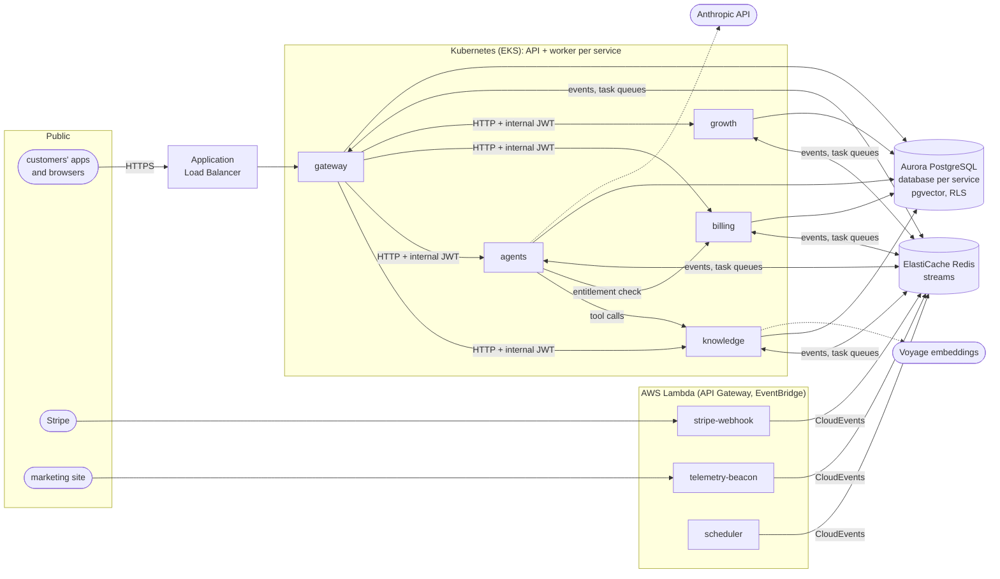
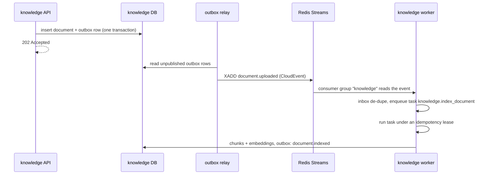
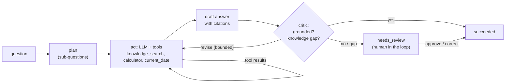
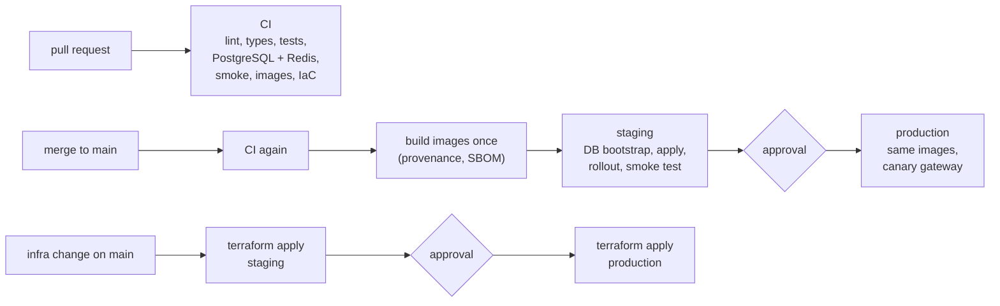

# Architecture

This document explains how the platform works and why it is built this way.
For a gentler introduction, read the [beginner's guide](beginners-guide.md)
first. The events the services exchange are listed in the
[event catalog](events.md).

## Principles

1. **Services own their data.** Each microservice has its own PostgreSQL
   database and is the only writer to it. Services share events and HTTP APIs,
   never tables.
2. **Announce, don't orchestrate.** A service records a change and announces it
   as an event in the same database transaction (a *transactional outbox*).
   Other services react on their own schedule. A slow or failed consumer never
   blocks the producer.
3. **Everything retries, so everything is idempotent.** Networks drop, workers
   crash and events are delivered at least once. Every handler, task and write
   API tolerates running twice.
4. **Tenant isolation is enforced twice.** Application code filters by tenant,
   and PostgreSQL row-level security enforces it again underneath.
5. **The same code runs everywhere.** `devstack` runs every service in one
   process with SQLite and an in-memory bus for development and tests.
   Production runs the identical service code as separate containers on
   PostgreSQL and Redis.

## System overview

| Service | Owns | Main responsibilities |
| --- | --- | --- |
| **gateway** | users, tenants, memberships, API keys, invitations, webhook endpoints and deliveries | Public API and OpenAPI, sign-up and login (JWT), RBAC, API keys, per-plan rate limits, `Idempotency-Key`, routing to internal services, outbound webhooks, queue operations for staff |
| **knowledge** | documents, chunks (with embeddings), feedback priors | Ingestion, chunking, embeddings, hybrid retrieval (vector + keyword), feedback-based re-ranking |
| **agents** | agent runs, steps, reviews, feedback | Planning, tool use, self-critique, token budgets, human-in-the-loop review, evaluation dataset |
| **billing** | subscriptions, credit ledger, usage records, revenue snapshots | Plans and entitlements, usage rating, quotas, Stripe sync, MRR/ARR reporting, invoice previews |
| **growth** | analytics events, accounts, experiments, assignments, marketing spend | Telemetry, funnels, cohorts, attribution, unit economics, experiments and autopilot, lead scoring |
| **serverless** | nothing (stateless) | Verify and translate Stripe webhooks, collect marketing-site analytics, trigger scheduled jobs |

Every service is a Python package built on the shared kernel,
[`platform-core`](../packages/platform-core/src/platform_core). One container
image per service runs as either `api` (HTTP) or `worker` (events and tasks),
so the two roles scale independently.

## The request path

1. The **Application Load Balancer** terminates TLS and forwards to a gateway
   pod.
2. **Authentication.** The gateway accepts a user access token (JWT, one hour)
   or an API key (`ank_<id>_<secret>`, stored as a SHA-256 hash and shown only
   once). Passwords are hashed with scrypt.
3. **Authorization.** The caller's role maps to permissions. API keys carry
   explicitly granted scopes, never more than their creator has.
4. **Edge policies.** A token-bucket rate limit applies per tenant and plan
   (60, 600 or 3,000 requests a minute; 30 for anonymous callers). For writes
   carrying an `Idempotency-Key`, the first response is stored, and a retry
   with the same key replays it (`idempotent-replayed: true`) instead of
   running twice.
5. **Routing.** Paths such as `/v1/documents` or `/v1/agents` are proxied to
   the owning service with a **short-lived internal JWT** (two minutes)
   describing the caller. Internal services trust only that token, never
   headers from the outside world. This is zero-trust between services.
6. The trace context (`traceparent`) travels with the request, so the whole
   path shows up as one distributed trace.

Internal service-to-service calls use the same token scheme, with retries and
a circuit breaker per downstream service, so a failing dependency fails fast
instead of piling up requests.

## Multi-tenancy

- The tenant comes from the caller's credentials and is held in a
  context variable for the request or task. Repository code always filters by
  it.
- Every tenant-owned table has a **row-level security** policy. Each
  transaction sets `app.tenant_id`, and PostgreSQL hides every other tenant's
  rows, even from a query that forgets its `WHERE tenant_id = ...`. Tests
  prove this against real PostgreSQL.
- Services connect as least-privilege roles (`NOSUPERUSER NOBYPASSRLS`), which
  [`platform_core.bootstrap`](../packages/platform-core/src/platform_core/bootstrap.py)
  creates. It refuses to continue if a role could bypass RLS.
- Trusted jobs that must see all tenants (revenue roll-ups, scheduled scoring)
  run under an explicit *system* principal that sets `app.bypass_rls`.
- Knowledge feedback, experiments assignments, rate limits and quotas are all
  per tenant.

## Events, tasks and reliability

- **Envelope.** Events are [CloudEvents 1.0](https://cloudevents.io) with two
  extensions: `tenantid` and `traceparent`. The type names are the contract,
  kept in [`catalog.py`](../packages/platform-core/src/platform_core/catalog.py).
- **Transactional outbox.** A state change and its event commit together, and
  a relay publishes them afterwards. There is no "saved but never announced"
  (or the reverse) when a process dies midway.
- **Streams and consumer groups.** All events go on one Redis stream. Each
  service reads it through its own consumer group, so every service sees every
  event, and replicas of one service share the work.
- **Event → task.** Each worker maps the event types it cares about to named
  tasks on its own queue. An *inbox* key per (consumer, task, event id) drops
  duplicate deliveries before they create duplicate work.
- **Task queues.** These are Redis streams with a delayed set for scheduled
  retries and a dead-letter stream. Consumer-group leases give a crashed
  worker's tasks to another replica.
- **Idempotent execution.** Each task runs under an idempotency key. States
  are *acquired* (run it), *in progress* (another replica holds the lease:
  retry later) and *completed* (return the stored result). Results are checked
  against the lease owner, so a slow worker can't overwrite a newer result.
- **Retries.** Exponential backoff with full jitter. By default a task gets 5
  attempts, with delays starting at 1 s and capped at 5 minutes. Webhook
  deliveries get up to 8 attempts, starting at 5 s. After the last attempt the task is
  **dead-lettered**, a `platform.task.dead_lettered` event is published, an
  alert fires, and staff can inspect and **redrive** it
  (`POST /v1/admin/queues/{queue}/dead-letters/{id}/redrive`).
- **Downstream idempotency.** Usage events carry idempotency keys, and the
  billing ledger has unique constraints on them. A redelivered usage event can
  never be billed twice. The same holds for Stripe events, which reuse
  Stripe's own event id.

## Retrieval-augmented generation

1. **Ingestion.** `POST /v1/documents` stores the text and returns `202`.
   Identical content already uploaded by the same tenant is de-duplicated (no
   second embedding bill).
2. **Chunking.** Text is split along headings and sentences into about 180
   tokens per chunk, with one sentence of overlap. Headings are kept as
   context. An embedding summarizes its whole input, so small focused chunks
   match questions far more precisely than whole documents.
3. **Embeddings.** In production: [Voyage](https://www.voyageai.com)
   (`voyage-3.5`). Offline: a deterministic hashing embedder (384 dimensions),
   so tests and the demo need no network.
4. **Indexes.** An HNSW index (pgvector, cosine) handles semantic search, and a
   GIN full-text index handles keyword search. Embeddings live next to the
   rows they describe, under the same row-level security.
5. **Hybrid retrieval.** Vector and keyword candidates are fused with
   **reciprocal rank fusion** (k = 60). Semantic search finds paraphrases, and
   keyword search finds exact terms such as error codes. Fusing ranks avoids
   having to calibrate their scores against each other.
6. **Feedback.** "Helpful" or "not helpful" ratings on agent answers update a
   per-tenant helpfulness prior for each cited chunk. That prior nudges future
   rankings (weight 0.2). This is the data flywheel: the product improves with
   each customer's own usage, which a competitor can't copy.

## Agentic orchestration

- **Runs are asynchronous.** `POST /v1/agents/runs` checks the tenant's
  entitlement with billing, stores the run and returns `202`. A worker executes
  it.
- **The orchestrator** runs plan → act → critique. Independent tool calls run
  in parallel. There is a maximum number of steps (6) and a per-run token
  budget (150,000); once the budget is spent, the model is asked for a final
  answer without tools.
- **The critic** scores groundedness: does every claim trace to a retrieved
  passage? It also detects knowledge gaps. It is heuristic by default, or can
  use an LLM (`AGENTS_CRITIC=llm`). Below the threshold, the run goes to
  **human review**. A reviewer's approval or correction completes it and
  becomes labelled data (`GET /v1/agents/dataset`) for evaluations and
  fine-tuning.
- **The model adapter** calls the Anthropic API through its official SDK,
  with the model set per environment (`AGENTS_MODEL`). It uses adaptive thinking, a configurable effort level, automatic prompt
  caching (the system prompt and tool definitions repeat on every step of the
  loop), structured outputs where a schema is given, and server-side refusal
  fallbacks. Rate limits, server errors and connection problems are retried by
  the task queue; refusals and other client errors fail the run with a clear
  reason. The **offline model** answers extractively from retrieved passages,
  with a relevance floor, so everything works without an API key.
- **Metering.** Input and output tokens plus one `agent_runs` unit per run are
  recorded as usage events, keyed by run, so retries never double-bill.

## Monetization

Pricing is **hybrid**: a subscription (the recurring base that ARR is built
on) plus **usage credits** that scale with the value delivered and cover the
variable inference cost.

| Plan | Price per month | Seats included (then) | Credits per month | Over the limit | API rate |
| --- | --- | --- | --- | --- | --- |
| Free | $0 | 3 (max 3) | 2,000 | blocked: HTTP 402 with an upgrade prompt | 60/min |
| Pro | $49 | 3 (+$15/seat) | 50,000 | $1.00 per 1,000 credits | 600/min |
| Enterprise | $1,500 | 25 (+$10/seat) | 1,000,000 | $0.60 per 1,000 credits | 3,000/min |

| Meter | Credits |
| --- | --- |
| LLM input tokens | 1 per 1,000 |
| LLM output tokens | 5 per 1,000 |
| Embedded tokens | 0.1 per 1,000 |
| Agent run | 2 each |
| Search | 0.5 each |

- Credits are integer *millicredits* and money is integer cents, so nothing is
  rounded twice.
- At 80% and 100% of the allowance, billing emits
  `billing.quota.threshold_reached`. Customers get in-product nudges and
  webhooks, and growth counts quota pressure toward lead scoring. On the free
  plan, 100% returns **HTTP 402** with `upgrade_to`. That is the product-led
  upgrade moment.
- **Stripe** is the payment system of record. Checkout and the customer portal
  happen at Stripe. Its webhooks arrive at a Lambda that verifies the
  signature (`t=...,v1=...`, five-minute tolerance) and translates them into
  platform events. Billing then applies the plan change, and the gateway syncs
  the new plan's rate limits.
- **Revenue reporting** (`GET /v1/billing/revenue`, staff only): MRR split into
  new, expansion, contraction, churned and reactivated; net and gross revenue
  retention; ARR = 12 × MRR. Inference gross margin compares credit revenue to
  model cost.

## Growth analytics

- **Telemetry** comes in two ways. Product events go through
  `POST /v1/telemetry/events`. Marketing-site page views go through the edge
  beacon Lambda, which sanitizes them and captures UTM and referrer data. In
  addition, growth *projects* domain events (sign-ups, indexed documents,
  agent runs, subscription changes) into its analytics store, so the product
  doesn't need separate tracking calls for them.
- **Live metrics** (`/v1/analytics/live`) are rolling counters of the last
  minutes of activity.
- **Funnel:** page viewed → signed up → document indexed → first successful
  agent run → converted to paid, with conversion at every step.
- **Cohorts:** weekly sign-up cohorts with their week-by-week retention. An
  account counts as active in a week if it logged in, indexed a document,
  searched, got an agent answer or gave feedback.
- **Attribution:** first-touch, last-touch, linear, time-decay and
  position-based (U-shaped, 40/20/40) credit across each account's marketing
  touches, compared side by side.
- **Unit economics:** ARPA = MRR ÷ paying accounts. CAC = marketing spend ÷
  new paying accounts. LTV = ARPA × gross margin ÷ monthly churn, with churn
  floored at 1% so a young business with no churn yet doesn't report an
  infinite LTV. Also LTV:CAC and CAC payback in months.
- **Experiments:** deterministic assignment (hash of experiment and subject:
  sticky, with no lookup table), then two-proportion z-test and Bayesian
  probability-to-beat-control. A **sample-ratio-mismatch** check halts broken
  experiments. The **autopilot** (a scheduled job) ships a treatment once it
  beats control with high probability, or keeps the control, but only after a
  minimum sample per variant.
- **Product-qualified leads:** free workspaces are scored on successful agent
  runs, indexed documents, active users, searches and quota pressure. Those
  above the threshold are announced (`growth.pql.identified`) for sales
  assistance.

Analytics endpoints require staff permissions (`analytics:read`); staff are
identified by the `STAFF_EMAILS` setting.

## Security

- **RBAC:** four tenant roles (owner ⊃ admin ⊃ member ⊃ viewer), plus staff
  permissions for the platform operator:

  | Permission | viewer | member | admin | owner |
  | --- | :-: | :-: | :-: | :-: |
  | read workspace, members, documents, agent runs; search | ✓ | ✓ | ✓ | ✓ |
  | write documents, run agents, give feedback, send telemetry | | ✓ | ✓ | ✓ |
  | manage members, API keys, webhooks; read billing | | | ✓ | ✓ |
  | manage billing and the workspace | | | | ✓ |

- **API keys** are scoped and stored hashed. **Webhooks** are signed with
  HMAC-SHA256 over the timestamp and body (so receivers can reject replays).
  Their URLs are checked against private and link-local address ranges
  (SSRF protection).
- **Secrets** live in AWS Secrets Manager (created by Terraform) and are synced
  into Kubernetes by External Secrets. Lambdas read theirs at cold start.
  Nothing secret is in git or in images.
- **Network:** default-deny ingress. Only the gateway accepts traffic from
  outside, and internal APIs accept only platform pods and Prometheus.
  Containers run as a non-root user with read-only file systems and all Linux
  capabilities dropped.
- **Cloud access:** each workload has its own IAM role (IRSA). CI/CD uses
  GitHub OIDC with roles only assumable from protected GitHub environments,
  so there are no stored cloud keys.

## Observability

- **Traces:** OpenTelemetry spans for HTTP (server and client), event
  publishing and consumption, task execution, LLM calls and tool calls. The
  trace context crosses the event bus inside each event, so an agent question
  is one trace from gateway to agents, knowledge, billing and growth. Locally
  it goes to Jaeger; in AWS the collector exports to X-Ray, alongside the
  Lambda traces.
- **Metrics** (Prometheus): HTTP rate, errors and latency per route; task
  outcomes and latency; queue depth; events published, consumed and
  duplicated; LLM tokens and latency; rate-limit hits; idempotent replays; and
  business counters (sign-ups, upgrades).
- **Logs:** structured JSON with the trace id, tenant and request id.
- **Alerts** ([`alerts.yml`](../infra/observability/alerts.yml)): gateway
  error-budget burn and p95 latency (SLOs), dead-lettered tasks, queue backlog,
  retry storms, LLM latency, token-spend spikes, and sign-ups stopping. Each
  links to its [runbook](runbook.md) section.
- **Dashboards:** a Grafana overview of traffic, errors, latency, queues, LLM
  usage and business events.

## Scalability and deployment

| Component | Scales by |
| --- | --- |
| Service APIs | Horizontal Pod Autoscaler on CPU; stateless, so any replica serves any tenant |
| Workers | KEDA on the depth of their Redis task queue (always at least one replica) |
| PostgreSQL | Aurora Serverless v2 (capacity units scale with load), with reader instances |
| Redis | ElastiCache with a replica in another availability zone and automatic failover |
| Edge functions | AWS Lambda, per request |

- **Availability:** multiple replicas spread across zones, PodDisruptionBudgets,
  readiness and liveness probes, graceful shutdown (workers finish their batch
  on SIGTERM), and rolling updates that never take capacity below 100%.
- **Releases:** production's public gateway rolls out as an **Argo Rollouts
  canary** (20% → 40% → 80% → 100%). Prometheus analysis runs on success rate
  and p95 latency, and a regression aborts the canary automatically.
- **Environments:** staging and production live in separate AWS accounts.
  Terraform creates the network, EKS (with access entries and IRSA), Aurora,
  ElastiCache, S3, ECR, Secrets Manager, the Lambda functions with API Gateway
  and EventBridge Scheduler, the GitHub OIDC roles, and the cluster add-ons
  the manifests rely on (External Secrets, KEDA, Argo Rollouts, AWS Load
  Balancer Controller, Prometheus, OpenTelemetry Collector).

## CI/CD

- Actions are pinned to commit SHAs, and downloaded tools are verified by
  checksum.
- Images are built once, then *promoted* (copied, not rebuilt) into each
  environment's registry.
- If a deploy is applied but doesn't become healthy, its Deployments are
  rolled back automatically.
- Details and first-time setup are in the [runbook](runbook.md).

## Key decisions and trade-offs

| Decision | Why | Trade-off |
| --- | --- | --- |
| **Redis Streams** for events and queues | One managed dependency covers the event bus, task queues, idempotency keys and rate limits. Consumer groups, acknowledgements and leases give at-least-once delivery. | Retention is bounded by memory. Very large event volumes or long replays would favor Kafka/MSK or Kinesis; the `EventBus` interface keeps that swap local. |
| **PostgreSQL + pgvector** instead of a separate vector database | Embeddings sit next to their rows under the same transactions, backups and row-level security. Hybrid search is one SQL query. | Past hundreds of millions of vectors per shard, a dedicated vector store could be cheaper to run. |
| **Database per service** | Services deploy and evolve independently; no hidden coupling through shared tables. | Cross-service reporting goes through events (growth projections) instead of joins. |
| **Transactional outbox** | Exactly-once *effects* without distributed transactions. | Consumers must be idempotent, which the platform enforces anyway. |
| **Lambda at the edge, containers for the core** | Spiky, stateless edge work costs nothing when idle. Steady services with connection pools and background workers fit containers. | Two runtime models; both share `platform-core` and the same events. |
| **Offline model and embedder** | Deterministic tests, a demo that needs no keys, and a degraded mode when a provider is unavailable. | Offline answers are extractive, not generative. |
| **Schema created at startup** (serialized by an advisory lock) | Zero-setup development and tests. | Production should move to versioned migrations (e.g. Alembic) run as a deploy step, like the database bootstrap Job. |
