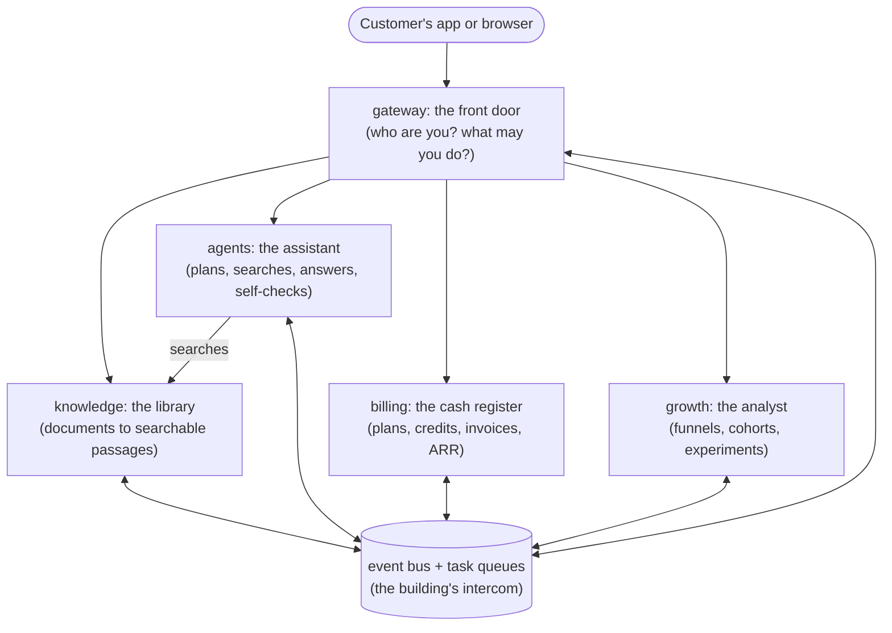

# A beginner's guide to this platform

This guide explains what the project is, who it is for and why it is built the
way it is. It assumes no background in cloud architecture. Every technical term
in the original brief is explained in the [glossary](#the-jargon-in-plain-english)
at the end.

## What is it, in one paragraph?

Imagine a company's support team drowning in repeated questions: *"How do I get
a refund?"*, *"Is my data encrypted?"*, *"What does error ERR-4521 mean?"*. The
answers already exist, scattered across handbooks, policies and help articles.
This platform lets that company **upload its documents and put an AI assistant
in front of them**. The assistant reads the relevant passages and answers in
plain language, citing its sources. When it isn't sure, it says so and asks a
human.

We are not building a website for one company. We are building the **product
that thousands of companies subscribe to**: software-as-a-service (SaaS).

## Who is involved?

| Who | What they do here |
| --- | --- |
| **Customers** (businesses) | Sign up, invite colleagues, upload documents, ask the agent questions, connect it to their own software through the API, pay a subscription. |
| **Their users** | Get answers. They may never know this platform exists. |
| **Us** (the company running the platform) | Keep it fast, safe and reliable, and watch which marketing and product changes turn visitors into paying, happy customers. |

## What is the goal?

The business goal is **annual recurring revenue (ARR)**: how much money the
subscriptions bring in per year, if nothing changes.

> A customer on the Pro plan pays $49 a month, so they add $49 × 12 = **$588 of
> ARR**. A thousand of them is about $588,000 of ARR. Revenue that repeats every
> month is what makes a software company valuable and predictable.

ARR grows when you:

1. **Attract** visitors (marketing), then
2. **activate** them: they sign up *and* get value quickly, for example their
   first good answer on day one,
3. **retain** them: they keep coming back week after week,
4. **expand** them: they add colleagues, use more, or upgrade.

Most of the "extra" requirements in the brief exist to measure and improve
exactly these four steps. The rest keep the platform running while it grows.

## A customer's journey through the system

Here is what happens, step by step, when a company called *Acme* discovers the
product. The service responsible for each step is named after the arrow.

1. **Someone at Acme reads our blog.** A tiny function at the edge of the
   network records the page view and where the visitor came from, without
   slowing the page down → *telemetry-beacon (serverless)*.
2. **They sign up for free, with no sales call.** A workspace is created for
   Acme. Its data is walled off from every other customer's → *gateway*.
3. **The free plan is set up automatically.** Billing hears the announcement
   "a new workspace exists" and gives it free monthly credits. Nobody had to
   call billing directly → *events*, *billing*.
4. **They upload their handbook.** It is split into small passages, each turned
   into a list of numbers that captures its meaning (an *embedding*) and
   stored. This happens in the background, so the upload returns instantly →
   *knowledge*, *task queue*.
5. **They ask: "How long do I have to request a refund?"** The AI agent plans,
   searches the handbook, writes an answer with citations, and then checks its
   own work. If the answer isn't supported by the documents, a human reviews
   it before it is used → *agents*.
6. **The usage is counted.** Each answer costs a few credits, depending on how
   much the AI had to read and write → *billing*.
7. **Acme runs out of free credits.** The next request gets a polite "upgrade
   to Pro" response (HTTP 402), exactly when Acme has seen the product's value
   → *billing*, *gateway*.
8. **Acme pays through Stripe.** Stripe notifies a serverless function, which
   verifies that the message really came from Stripe. The plan changes, and
   ARR grows by $588 → *stripe-webhook (serverless)*, *billing*.
9. **Acme rates an answer "helpful".** Next time, passages that helped *Acme*
   rank higher for *Acme* only. The product gets better the more each customer
   uses it → *knowledge*.
10. **We watch it all.** Dashboards show how many visitors sign up, how many
    get a first answer, which channels bring paying customers, and which
    onboarding experiment works better → *growth*.

You can watch this whole story run in about ten seconds:

```bash
uv sync --all-packages
uv run devstack demo
```

## Try the API yourself

Start the platform on your machine (no Docker, cloud or keys needed):

```bash
uv run devstack serve     # then open http://127.0.0.1:8000/docs
```

In a second terminal, sign up, upload a document and ask a question:

```bash
BASE=http://127.0.0.1:8000

# 1. Sign up. The response contains an access token for the new workspace.
TOKEN=$(curl -s -X POST $BASE/v1/auth/signup -H 'content-type: application/json' \
  -d '{"email": "ada@example.com", "password": "correct-horse-battery", "workspace_name": "Acme Support"}' \
  | python3 -c 'import sys, json; print(json.load(sys.stdin)["access_token"])')
AUTH="authorization: Bearer $TOKEN"

# 2. Upload a document. It is indexed in the background (status "pending", then "indexed").
curl -s -X POST $BASE/v1/documents -H "$AUTH" -H 'content-type: application/json' \
  -d '{"title": "Refund policy", "content": "Customers can request a full refund within 30 days of purchase. Refunds are paid to the original payment method within five business days."}'

# 3. Ask the agent. It answers asynchronously; poll the run for the result.
RUN=$(curl -s -X POST $BASE/v1/agents/runs -H "$AUTH" -H 'content-type: application/json' \
  -d '{"question": "How long do I have to ask for a refund?"}' \
  | python3 -c 'import sys, json; print(json.load(sys.stdin)["id"])')
sleep 3
curl -s $BASE/v1/agents/runs/$RUN -H "$AUTH"
# -> "status": "succeeded", "answer": "Customers can request a full refund within 30 days of purchase [1]. ..."

# 4. See what that cost in credits.
curl -s $BASE/v1/billing/usage -H "$AUTH"
```

Without an API key, the agent uses a simple offline model that quotes the
best-matching passages. Set `ANTHROPIC_API_KEY` and `AGENTS_MODEL` (the model
to use) before `devstack serve` to use the Anthropic API instead.

## How the pieces fit



Each box is a separate program (a *microservice*) with its own database. They
mostly talk by **announcing events** ("document indexed", "plan changed")
instead of calling each other. That way one of them being slow or down doesn't
stop the others.

## The jargon, in plain English

**Architecture words**

- **Multi-tenant**: one running system serves many customer companies (the
  *tenants*), like one apartment building with many locked apartments. Every
  query is limited to one tenant twice: in the code, and by the database itself
  (*row-level security*), so a bug in one place still cannot leak another
  customer's data.
- **Event-driven architecture**: services announce what happened ("a workspace
  was created") and whoever cares reacts. The announcer doesn't wait and
  doesn't need to know who is listening.
- **Serverless compute**: small functions that the cloud provider runs only
  when needed and bills per call. They suit spiky, short jobs such as payment
  notifications, analytics pings and nightly jobs.
- **Containerized microservices**: the product is split into small programs,
  each packaged with everything it needs (a *container*) so it runs the same on
  a laptop and in the cloud. Each can be updated and scaled on its own.
- **API-first**: everything the product does is available through a documented
  programming interface (API), so customers can plug it into their own tools.
  The web app is just one client of it.
- **Horizontal scalability**: handling more load by running *more copies* of a
  service rather than buying a bigger machine. The services keep no state in
  memory, so any copy can serve any request.

**AI words**

- **Agentic orchestration**: instead of answering in one shot, the AI works in
  steps: make a plan, use tools (search the documents, do arithmetic), draft
  an answer, review it. The platform controls those steps and enforces budgets
  and safety checks.
- **Retrieval-augmented generation (RAG)**: before the AI answers, it
  *retrieves* the most relevant passages from the customer's documents. It
  answers from those passages, which keeps answers grounded and citable.
- **Vector embeddings**: a way to turn text into a list of numbers so that
  texts with similar meanings get similar numbers. "Refund window" and "how long
  to return" end up close together, even though they share no words.

**Reliability words**

- **Asynchronous tasks and queues**: slow work (indexing a big document,
  running the agent) goes on a to-do list that background workers process. The
  customer gets an instant "accepted" and checks back later.
- **Idempotent execution**: doing something twice has the same effect as doing
  it once. When the network hiccups and a request or task is retried, nobody is
  charged twice and nothing is created twice.
- **Fault-tolerant retries**: when a step fails temporarily, it is retried
  later, waiting a little longer each time (*exponential backoff*). A task that
  keeps failing is set aside in a *dead-letter queue* for a human to inspect and
  replay.

**Growth words**

- **Acquisition funnel**: the steps from stranger to paying customer (visit →
  sign up → first value → pay). Each step loses people; the funnel shows where.
- **Real-time telemetry**: recording what users do, as it happens, as events.
- **Activation**: a new user reaching their first real value. Here, that is
  the first good answer.
- **Retention and cohort analytics**: group customers by the week they signed
  up (a *cohort*) and track what share is still active in week 1, 2, 3... This
  shows whether the product is getting stickier over time.
- **Attribution modeling**: deciding how much credit each marketing channel
  (ads, blog, newsletter) deserves for a customer who touched several of them.
- **Automated A/B testing**: show two versions of something (say, onboarding
  with or without a checklist) to randomly split groups, measure which works
  better, and ship the winner automatically once the evidence is strong enough.
- **LTV and CAC**: *lifetime value* is how much a customer pays us over their
  whole relationship. *Customer acquisition cost* is how much marketing we spent
  to win one. A healthy software business wants LTV:CAC of at least 3:1.
- **Product-led growth (PLG)**: the product sells itself. People try it free,
  get value, and upgrade inside the product instead of talking to sales first.
- **Usage-based monetization**: customers pay more when they use more (here,
  credits per AI answer, search and document), on top of a base subscription.
  Price tracks value, and it also covers the real cost of running the AI.
- **Defensible data feedback loop**: every rating and every human correction
  makes the product better for that customer. That advantage is hard for a
  competitor to copy, because it is built from usage.

**Operations words**

- **CI/CD**: *continuous integration* tests every change automatically;
  *continuous delivery* ships tested changes to production automatically,
  gated by approvals and safety checks.
- **Infrastructure as code (IaC)**: the cloud setup (networks, databases,
  clusters) is written as code (Terraform here), so it can be reviewed,
  versioned and recreated exactly.
- **Distributed tracing**: one customer request touches several services. A
  *trace* follows it through all of them, so you can see where time went or
  where it failed.
- **Role-based access control (RBAC)**: people get *roles* (owner, admin,
  member, viewer), and roles grant *permissions*. A viewer can read but cannot
  delete documents or change billing.
- **End-to-end observability**: logs, metrics and traces together let you
  answer "what is happening and why" without guessing. Alerts fire when
  something drifts, such as error rates or failed tasks.

## Where to go next

- [Architecture](architecture.md): how each part works and why it was built
  that way.
- [Event catalog](events.md): every event the services exchange.
- [Runbook](runbook.md): deploying, operating and fixing the platform.
